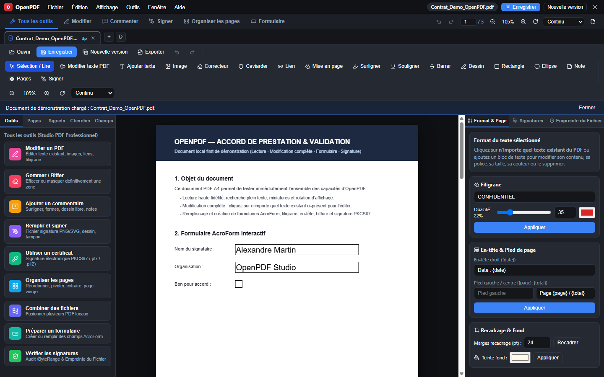
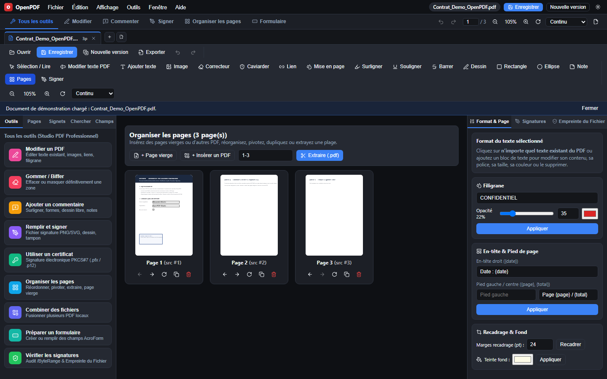
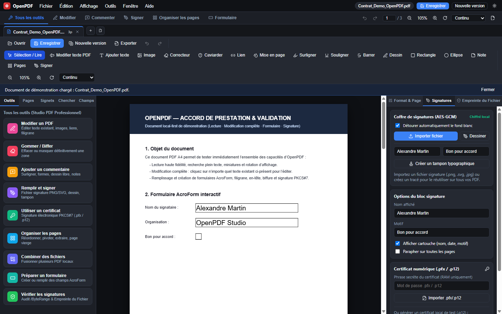
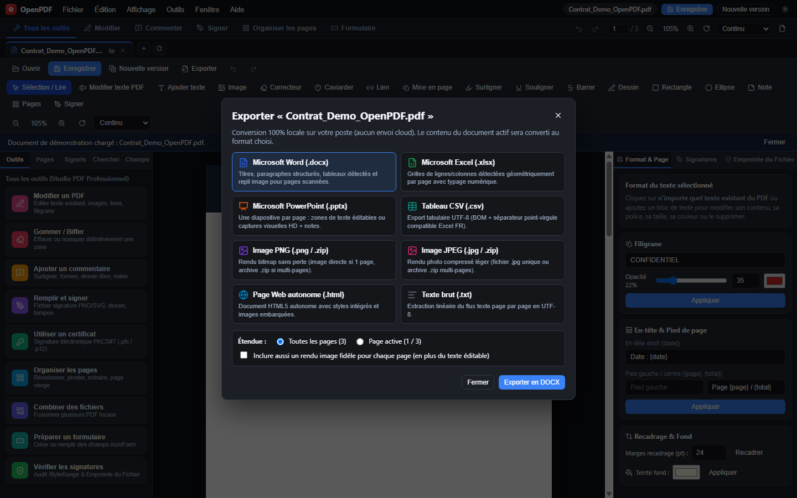
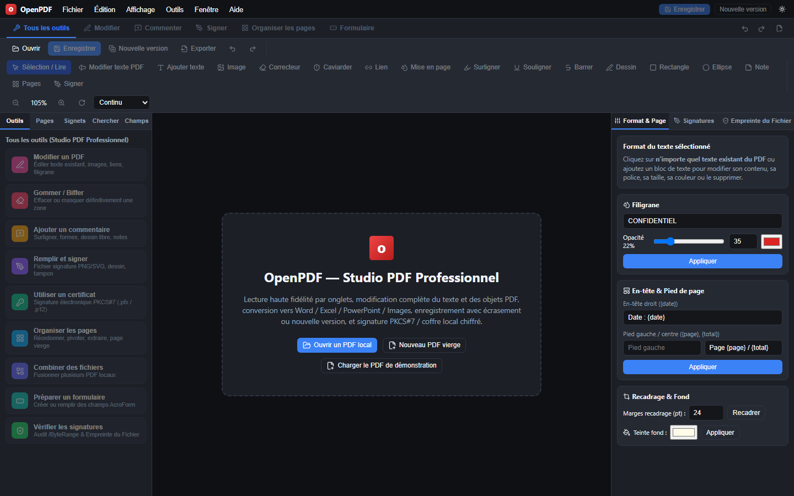

# 📄 OpenPDF

### Le studio PDF local-first, libre et souverain
**L'alternative moderne, performante et sans abonnement à Adobe Acrobat Pro.**

 

  

<!-- Hero Image -->

  

*OpenPDF en action : interface inspirée d'Acrobat Pro, lecture multi-onglets, barre d'outils complète et inspecteur de propriétés.*

---

## 🌟 Visite Guidée de l'Application

### 1. Éditeur de Contenu & Annotations
> Modifiez vos documents avec la même souplesse qu'un traitement de texte, directement sur les calques du PDF.

  

- **Édition de texte & formulaire** : Cliquez sur n'importe quel texte ou champ de formulaire interactif (`AcroForm`) pour le modifier en temps réel.
- **Annotations complètes** : Surlignage translucide, souligné, barré, formes géométriques (rectangles, ellipses), tracé libre et notes repositionnables.
- **Caviardage & Biffure opaque** : Masquage garanti et suppression physique définitive du texte sensible dans le fichier sauvegardé.

---

### 2. Réorganisation & Manipulation des Pages
> Glissez, déposez, pivotez et assemblez vos documents en toute simplicité.

  

- **Mosaïque visuelle interactive** : Vue d'ensemble de l'ensemble des pages avec miniatures générées en temps réel.
- **Glisser-Déposer (*Drag & Drop*)** : Réorganisez l'ordre des pages instantanément.
- **Actions en un clic** : Rotation horaire/anti-horaire par page, suppression sécurisée, insertion de pages vierges et extraction vers un nouveau document.

---

### 3. Signature Électronique PKCS#7 & Coffre-Fort Local
> Signez vos contrats et documents officiels avec un scellement cryptographique conforme aux normes Adobe Acrobat.

  

- **Signature visuelle & Tampons** : Tracez votre signature manuscrite à la souris/pavé tactile, importez un fichier image (`.png`, `.svg`) avec détourage automatique du fond blanc, ou générez un tampon typographique.
- **Signature numérique légale (`.pfx` / `.p12`)** : Déverrouillage sécurisé de votre certificat X.509, hachage SHA-256, calcul de la table `/ByteRange` et scellement PKCS#7 détaché (`adbe.pkcs7.detached`).
- **Coffre-fort local chiffré (`SignatureVault`)** : Vos griffes et tampons restent enregistrés localement dans IndexedDB pour vos prochaines signatures, sans jamais persister vos mots de passe.

---

### 4. Conversion & Export Multi-Formats
> Exportez vos documents PDF vers les formats bureautiques courants en un clic, 100 % hors-ligne.

  

- **Microsoft Word (`.docx`)** : Conversion structurée avec détection des titres, paragraphes et tableaux.
- **Microsoft PowerPoint (`.pptx`)** : Génération de diapositives par page avec blocs de texte positionnés.
- **Microsoft Excel (`.xlsx`) & CSV** : Détection des grilles tabulaires et extraction de données.
- **Web & Images** : Export en page Web autonome (`.html`) ou en archive ZIP (`.png` / `.jpeg`) haute fidélité.

---

### 5. Accueil & Espace de Travail Multi-Onglets
> Travaillez sur plusieurs dossiers simultanément sans ralentissement.

  

- **Hub de démarrage rapide** : Ouvrez un PDF local, créez un document vierge ou chargez le PDF de démonstration interactif.
- **Navigation par onglets** : Ouvrez plusieurs PDF en parallèle avec gestion indépendante de l'historique (*Undo/Redo* jusqu'à 200 étapes) et du zoom.
- **Protection anti-perte de données** : Alerte de confirmation lors de la fermeture si des modifications n'ont pas été enregistrées.

---

## 🥊 Pourquoi Choisir OpenPDF ?

| Critère | OpenPDF | Adobe Acrobat Pro | Outils en Ligne (Smallpdf, iLovePDF...) |
| :--- | :---: | :---: | :---: |
| **Tarif** | **100 % Gratuit & Open Source** | ~287 € / an (Abonnement obligatoire) | Freemium / Payant |
| **Confidentialité & Données** | **100 % Local** (Zéro Cloud) | Téléversement Cloud Adobe | Téléversement sur serveurs tiers |
| **Usage Hors-Ligne** | **Totalement autonome** | Connexion requise périodiquement | Impossible sans Internet |
| **Signature Cryptographique** | **Inclus (PKCS#7 / PFX)** | Inclus | Souvent payant ou non-conforme |
| **Poids & Performance** | **Léger (< 15 Mo)** | Lourd (> 1,5 Go) | Dépend du navigateur |
| **Licence** | **GNU GPL-3.0** | Propriétaire fermée | Propriétaire fermée |

---

## 🔒 Souveraineté & Confidentialité Absolue

- **Aucun envoi réseau** : Vos contrats, factures et documents sensibles ne quittent jamais votre machine.
- **Sauvegarde atomique sécurisée** : Les documents ne sont jamais modifiés en direct. Toute sauvegarde passe par un fichier temporaire de staging (`.staging.tmp`) pour éviter toute corruption en cas de coupure inattendue.
- **Budgets d'admission stricts** : Protection contre les fichiers malformés ou piégés (rejet automatique si non-conforme aux standards ISO 32000-1).

---

## 📥 Télécharger et Installer

1. Téléchargez la dernière version : **[OpenPDF pour Windows (x64)](https://github.com/SharkLog76/OpenPDF/releases/latest)**.
2. Lancez l'installeur `OpenPDF_x.x.x_x64-setup.exe` (ne nécessite aucun droit administrateur).
3. Profitez immédiatement d'un studio PDF complet, fluide et gratuit.

Pour consulter le journal détaillé de toutes les versions : **[Changelog officiel (CHANGELOG.md)](CHANGELOG.md)**.

---

## 📖 Référentiel Technique & Architecture

Pour les développeurs et contributeurs souhaitant explorer ou étendre le code :
- [Index Technique & Navigation Zéro-Token](docs/architecture/index.md)
- [Vue Globale de l'Architecture](docs/architecture/overview.md)
- [Processus Métier de Bout en Bout](docs/architecture/processes-and-workflows.md)
- [Contrats, Modèles & Catalogue d'Erreurs](docs/architecture/contracts-and-domain.md)

---

## ⚖️ Licence

Ce projet est distribué sous licence libre **GNU General Public License v3.0** (GPL-3.0). Consultez le fichier [LICENSE](LICENSE) pour plus de détails.
