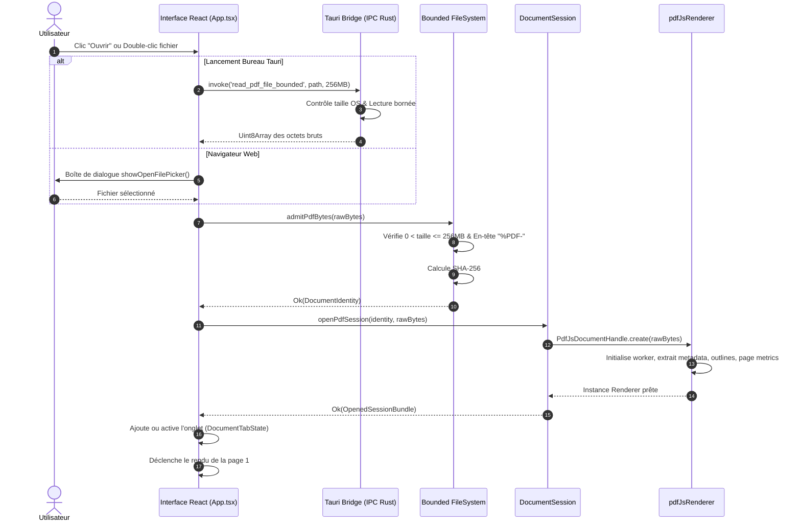
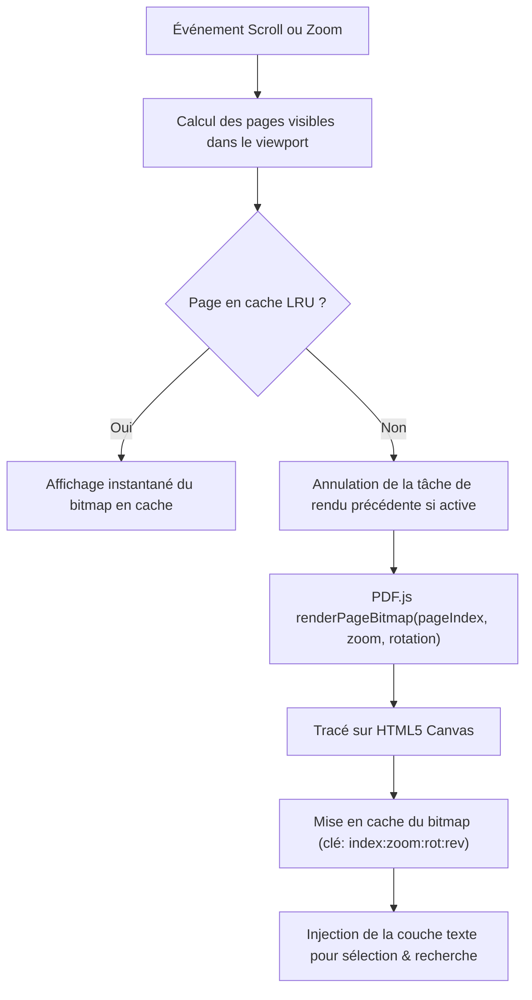
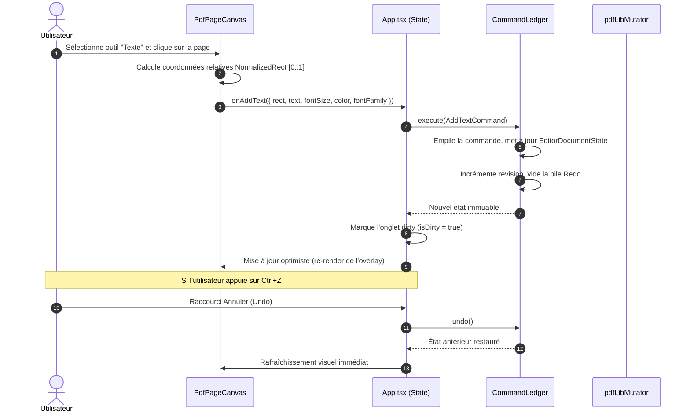
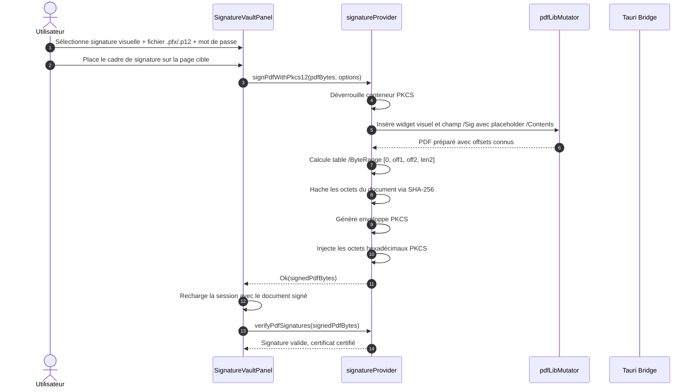
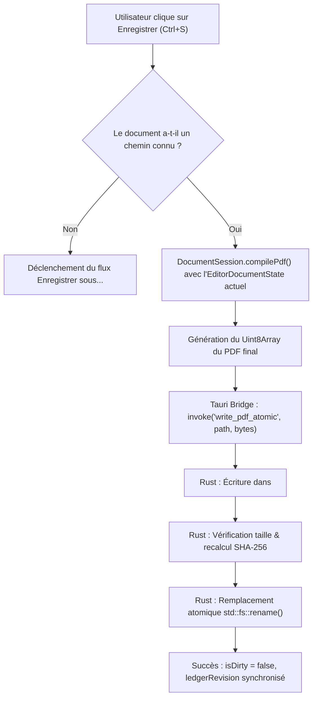

# Processus Métier de Bout en Bout (Workflows)

Ce document décrit en détail les algorithmes et les flux d'exécution pour chaque cas d'usage clé d'**OpenPDF**.

---

## Processus 1 : Démarrage et Ouverture d'un Document

1. **Vérification d'instance unique (Rust)** : Si l'application est déjà ouverte, l'événement `open-pdf-request` transmet le chemin du fichier sans créer de nouvelle fenêtre.
2. **Admission bornée** : Tout fichier rejeté (trop volumineux, non-PDF) génère une `DomainError` explicite affichée dans un bandeau toast.
3. **Ouverture de session** : Le bundle créé comprend le parseur de métadonnées, le sommaire hiérarchique, les champs de formulaires existants et l'historique `CommandLedger` initialisé.

---

## Processus 2 : Rendu des Pages et Virtualisation du Viewport

- **Clé d'invalidation du cache** : Le cache LRU (12 pages max) est invalidé dès qu'une modification sur la page est appliquée (`revision` incrémentée) ou que le zoom/rotation change.
- **Réactivité UI** : Les rendus annulés ne bloquent pas le thread de l'interface utilisateur.

---

## Processus 3 : Édition de Contenu et Gestion de l'Historique

Ce processus s'applique à l'ajout de texte, biffures (caviardage), surlignages, annotations, et modifications de formulaires.

- **Biffures (Caviardage)** : Les blocs de masquage créés sont physiquement appliqués lors de la compilation par `pdfLibMutator`, garantissant que le texte masqué est définitivement supprimé du document final.

---

## Processus 4 : Réorganisation et Gestion des Pages

1. **Affichage de la grille d'organisation** : Le composant `PageOrganizerGrid.tsx` affiche l'ensemble des pages sous forme de vignettes avec leur numéro d'origine.
2. **Glisser-Déposer (Drag & Drop)** : L'utilisateur réordonne les vignettes. L'ordre cible est consigné dans `state.pageOrder`.
3. **Rotation individuelle ou globale** : Envoi de la commande `SetPageRotationCommand(pageIndex, angle)`. L'angle est normalisé selon `(rotation + 90) % 360`.
4. **Suppression de page** : Vérification de la règle de sécurité métier : interdiction formelle de supprimer la dernière page restante (`CannotDeleteLastPage`).
5. **Extraction de pages** : La fonction `extractPdfPageRange(bytes, range)` isole les pages voulues dans un nouveau document PDF indépendant ouvert dans un nouvel onglet.
6. **Fusion de documents** : La fonction `mergePdfDocuments([docA, docB, ...])` concatène les flux en respectant le budget d'admission de 512 Mo (`MAX_MERGE_TOTAL_BYTES`).

---

## Processus 5 : Signature Électronique et Coffre-Fort

- **Coffre-fort local** : Les signatures manuscrites et tampons graphiques sont stockés dans le coffre-fort local persistant (`signatureVaultStore.ts`).
- **Protection des données sensibles** : Les mots de passe et clés privées ne sont **jamais stockés**, ni journalisés. Ils sont consommés en mémoire vive pour l'opération de signature et immédiatement détruits.

---

## Processus 6 : Sauvegarde Atomique et Écrasement Sécurisé

- **Garantie de non-corruption** : En cas de coupure de courant ou de blocage pendant l'écriture disque, le fichier d'origine reste intact car le fichier temporaire de staging n'a pas encore remplacé la cible.

---

## Processus 7 : Conversion et Export Multi-Formats

1. **Sélection du format** : Via la fenêtre `ExportFormatsModal.tsx` (`Word .docx`, `PowerPoint .pptx`, `Excel .xlsx`, `Page Web .html`, `Archive PNG/JPEG .zip`, `Texte brut .txt`).
2. **Options d'export** : Choix des pages (toutes, page active, plage personnalisée), qualité des images et préservation des blocs.
3. **Orchestration (`DocumentExportService`)** :
   - Émission d'un événement de début (`ConversionProgress: phase 'analyzing'`).
   - Extraction structurée du texte et des images via `pdfJsRenderer`.
   - Routage vers le provider de conversion dédié (`docxExporter`, `pptxExporter`, etc.).
   - Émission de la progression par page traitée.
   - Assemblage et compression ZIP le cas échéant (`fflate`).
4. **Livraison du fichier** :
   - Sous Tauri : Boîte de dialogue native d'enregistrement et écriture atomique (`write_binary_file_atomic`).
   - Sous Web : Téléchargement direct du Blob généré.

---

## Processus 8 : Gestion Multi-Onglets et Fermeture

1. **Création d'un onglet (`openTab`)** : Chaque onglet possède son propre identifiant `tabId`, son chemin de fichier, son historique propre et ses paramètres de vue (zoom, page active).
2. **Bascule d'onglet (`setActiveTab`)** : L'interface désabonne le canvas de l'ancienne session et rattache le nouvel onglet sans recharger les octets disque.
3. **Fermeture d'onglet (`closeTab`)** :
   - Si `isDirty === true` : Une boîte de dialogue modale s'affiche avec trois choix : *Enregistrer*, *Ne pas enregistrer*, ou *Annuler*.
   - Après confirmation : Libération explicite des ressources graphiques et des descripteurs (`session.destroy()`).
4. **Fermeture de l'application** : Parcours séquentiel de l'ensemble des onglets avec alerte groupée si des modifications non sauvegardées existent.
