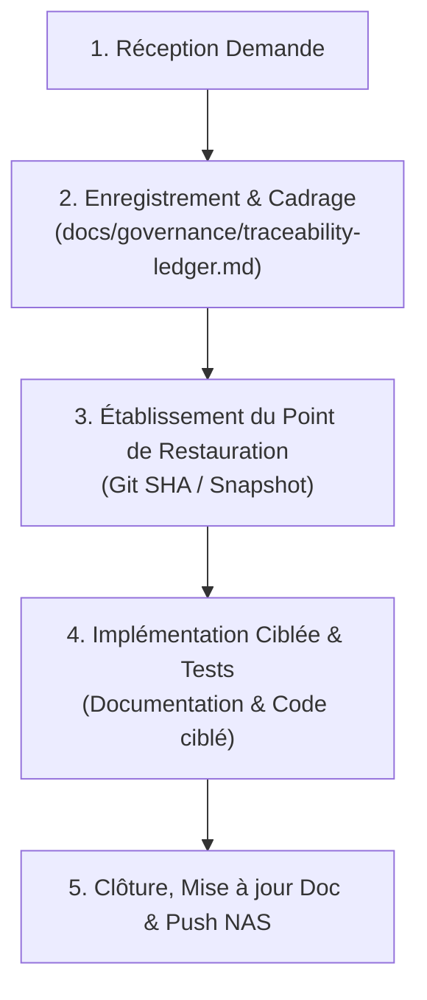

# Règles de Gestion de Projet — OpenPDF

Ce document établit le cadre de gouvernance opérationnel obligatoire pour toute intervention technique sur le projet **OpenPDF**.
Il garantit la **traçabilité intégrale** de chaque demande utilisateur, une **réversibilité immédiate** en cas d'anomalie, et une **économie drastique de tokens** en s'appuyant sur le référentiel documentaire sans relecture exhaustive du code source.

---

## 1. Principes Directeurs de Fonctionnement

1. **Zéro consommation inutile de tokens** : L'agent ou le développeur consulte en priorité l'index et les guides d'architecture (`docs/architecture/`) avant de cibler précisément le ou les fichiers concernés. La lecture de fichiers entiers non ciblés est proscrite.
2. **Traçabilité systématique** : Chaque demande formulée par l'utilisateur fait l'objet d'une entrée horodatée dans le registre de traçabilité ([docs/governance/traceability-ledger.md](file:///c:/Users/Alexandre/Desktop/Developpements/OpenPDF/docs/governance/traceability-ledger.md)).
3. **Réversibilité garantie (Fail-Safe & Rollback)** : Aucun changement n'est appliqué sans point de restauration identifié (SHA de commit, branche dédiée ou tag). Chaque modification est atomique et réversible via une commande documentée.
4. **Synchronisation avec le NAS** : Tout travail validé est commité selon les conventions et synchronisé avec le dépôt bare hébergé sur le NAS (`origin`).

---

## 2. Cycle de Vie d'une Demande (Workflow en 5 Étapes)

Pour chaque demande de l'utilisateur, le processus suivant est scrupuleusement déroulé :

### Étape 1 : Réception et Qualification
- Identifier le domaine fonctionnel impacté (Visionneuse, Éditeur, Signature, Convertisseur, Shell/Multi-onglets, Bridge Tauri).
- Déterminer les composants, contrats ou providers concernés à l'aide de l'[Index d'Architecture](file:///c:/Users/Alexandre/Desktop/Developpements/OpenPDF/docs/architecture/index.md).

### Étape 2 : Enregistrement de la Demande
- Créer ou mettre à jour la fiche de demande dans [docs/governance/traceability-ledger.md](file:///c:/Users/Alexandre/Desktop/Developpements/OpenPDF/docs/governance/traceability-ledger.md) avec un identifiant unique `REQ-YYYYMMDD-XX` :
  - **Identifiant & Date**
  - **Description du besoin utilisateur**
  - **Périmètre & Fichiers cibles identifiés**
  - **Critères d'acceptation et tests requis**

### Étape 3 : Point de Restauration & Plan de Réversibilité
- Noter le commit Git de référence (`BASE_COMMIT`).
- Définir la commande exacte de retour arrière :
  - Si travail sur branche : `git checkout main && git branch -D feature/<nom>`
  - Si commit direct : `git revert <COMMIT_SHA>` ou `git reset --hard <BASE_COMMIT>`
- Si des fichiers de configuration ou clés sont impactés, une copie de sauvegarde `.bak` temporaire est réalisée.

### Étape 4 : Implémentation Atomique et Vérification
- Appliquer les modifications strictement circonscrites aux modules cibles.
- Ne pas toucher aux interfaces stables sans mise à jour des contrats (`src/contracts/`).
- Exécuter la suite de tests automatisés (`npm.cmd test`).
- Vérifier que la compilation TypeScript est propre (`npx.cmd tsc --noEmit`).

### Étape 5 : Clôture, Maintenance Documentaire, Release & Synchronisation NAS
- Mettre à jour la documentation d'architecture si un contrat, un flux ou une structure a évolué (la documentation reste le reflet fidèle du code).
- Mettre à jour le statut dans le registre de traçabilité (`Statut: COMPLÉTÉ`).
- **Cycle de Release Automatique** : Dès qu'une évolution fonctionnelle, ergonomique ou de sécurité est validée et testée :
  1. Incrémenter le numéro de version selon SemVer dans `package.json`, `src-tauri/tauri.conf.json` et `src-tauri/Cargo.toml`.
  2. Documenter le `CHANGELOG.md` avec les ajouts, correctifs et impact utilisateur.
  3. Produire un commit normé (Conventional Commits, ex. `feat:`, `fix:`, `docs:`, `refactor:`).
  4. Créer le tag Git correspondant (`vX.Y.Z`).
  5. Pousser la branche et le tag vers le NAS (`origin`) et GitHub (`github` / `origin`) pour déclencher la CI/CD et publier les installeurs exécutables.

---

## 3. Matrice de Réversibilité et Commandes de Rollback

| Scénario | Action Préventive | Procédure de Reversibilité (Rollback) |
| :--- | :--- | :--- |
| **Modification simple de code** | Vérification de l'état `git status` propre avant de débuter | `git restore .` (si non commité) ou `git revert HEAD --no-edit` (si commité) |
| **Refactorisation lourde ou feature complexe** | Création d'une branche `feature/REQ-XX` ou d'un tag de sauvegarde | `git checkout main && git branch -D feature/REQ-XX` |
| **Altération involontaire de fichier critique** | Historique Git local et distant | `git checkout origin/main -- <chemin_fichier>` |
| **Échec après Push sur le NAS** | Commit identifié sur le NAS | `git revert <COMMIT_SHA> && git push origin main` |

---

## 4. Règles de Préservation de Contexte et Économie de Tokens

Afin de ne jamais saturer le contexte de travail de l'IA et de minimiser le coût d'inférence :

1. **Consulter l'Index Technique en premier** : Avant de lire un fichier source, consulter [docs/architecture/index.md](file:///c:/Users/Alexandre/Desktop/Developpements/OpenPDF/docs/architecture/index.md).
2. **Lecture par plages délimitées** : Utiliser `read_file` avec `StartLine` et `EndLine` sur les sections précises documentées, plutôt que d'injecter des fichiers de 1 000 lignes dans le prompt.
3. **Mise à jour incrémentale de la documentation** : Dès qu'une nouvelle fonctionnalité est ajoutée, enrichir la documentation correspondante pour que les requêtes futures bénéficient immédiatement de la connaissance sans analyse de code.
4. **Documentation comme contrat d'autorité** : Le code doit se conformer à l'architecture documentée. Si un doute subsiste, la documentation fait foi ou doit être alignée explicitement.
